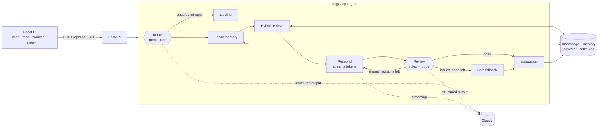

# Ashariri

**A digital twin that answers in your voice, grounded in what you have actually said, written and built.**

For anyone who wants an answer from you when you can't be there: friends with plans, family with news, strangers with questions, recruiters with follow-ups.

> **Status: work in progress.** Ashariri is the first version of my own digital twin. Today it talks about my work in my voice and checks itself before it answers. Over time it will learn from what I write, speak in my voice and, with my approval, act on my behalf. The repo ships with a fictional example persona so anyone can run it and make it theirs.

**The name.** From the Sanskrit *aśarīrin*, "bodiless". In Tamil, asariri (அசரீரி) is the voice from the sky in the old epics and stories: a voice that speaks with no one there.

Ashariri is an agent, not a chatbot with a long prompt. Each question goes through a LangGraph state machine. The graph routes the question, recalls what this visitor has told it, runs a hybrid search over the persona's own writing, and streams a cited draft. A review step then checks the draft against hard rules and an LLM judge, and sends it back for revision if it fails. Every step streams to the UI, so you can watch the agent work.

https://github.com/user-attachments/assets/307e793a-f145-42b9-88cc-c0fbe7c9f0fc

<sub>▶ The film, with sound. <a href="#the-film">How it was made</a>.</sub>

## What it shows

| | |
|---|---|
| **Agent orchestration** | A LangGraph `StateGraph` with conditional routing, a bounded self-correction loop and a safe fallback |
| **Grounded answers** | Hybrid retrieval: vector search plus BM25, merged with reciprocal rank fusion. Citations are inline and clickable |
| **Guardrails** | Deterministic rules (confidential names, personal data, unsupported figures) plus a structured-output LLM judge |
| **Memory with consent** | Episodic and semantic memory scoped to a session. Visitors can see it, switch it off and erase it |
| **Observability** | Every node emits typed events over SSE: the route taken, the passages and their ranks, the verdicts and the timings |
| **Evals** | A YAML suite that scores routing, retrieval hit rate, outcomes and safety on every answer. It runs in CI |
| **Two storage backends** | SQLite + sqlite-vec + FTS5 for zero-infrastructure runs. Postgres + pgvector + tsvector for production |
| **Voice** | Web Speech API for spoken questions and spoken replies |
| **Persona as data** | Name, voice, boundaries, avatar and suggested questions live in one YAML file. No code changes to make it yours |

## Quick start

Runs offline in about two minutes, with no API key. The scripted model answers extractively from the retrieved sources, which is enough to see the whole agent loop.

```bash
cd backend
uv sync
ASHARIRI_LLM=scripted ASHARIRI_SCRIPTED_DELAY=0.04 uv run ashariri serve   # API on :8000
cd ../frontend && pnpm install && pnpm dev                                 # UI on :5173
```

Open http://localhost:5173 and you are talking to **Alex Example**, a fictional persona with sample knowledge.

**With Claude:**

```bash
export ANTHROPIC_API_KEY=sk-ant-...
cd backend && uv run ashariri serve
```

**Full stack with Postgres:**

```bash
cp .env.example .env    # add your key, or set ASHARIRI_LLM=scripted
docker compose up --build
open http://localhost:8080
```

**From the terminal:**

```bash
uv run ashariri chat --trace    # chat, with each graph step printed
uv run ashariri ingest          # rebuild the index after editing knowledge/
uv run ashariri eval --verbose  # run the evaluation suite
```

## Make it yours

The persona and the knowledge are data, not code. Everything below happens in `backend/`.

**1. Keep your files private.** `backend/private/` is git-ignored, so your real persona and writing never reach a public fork.

```bash
mkdir -p private/persona private/knowledge
cp persona/example.yaml private/persona/me.yaml
```

**2. Write the persona.** In `private/persona/me.yaml`, set your name, role, public email, voice, beliefs and boundaries. The UI fields (`tagline`, `greeting`, `suggestions`) set the welcome screen.

**3. Add your knowledge.** One markdown file per topic in `private/knowledge/`: your profile, case studies, essays, talks, reading. Each file starts with a small front matter block, and headings become retrievable passages:

```markdown
---
title: "A support agent that drafts, a human that sends"
url: "https://example.com/work/support-agent"
kind: "case-study"
---

# The problem
One or two short paragraphs per heading work best.
```

The files in `knowledge/` are samples to copy from. Only state facts you are happy for the twin to repeat: the judge holds every answer to these sources.

**4. Add your photo.** Put an image in `frontend/public/` named `me.webp` (or `me.png`, `me.jpg`; all git-ignored) and set `avatar: /me.webp` in your persona.

**5. List what must never be said.** Internal project names go in `private/persona/confidential.local.yaml`, a plain YAML list next to your persona. The guardrail blocks any reply that contains one.

```yaml
- Project Codename
- Internal Tool Name
```

**6. Point the twin at your files and rebuild the index.**

```bash
export ASHARIRI_PERSONA_PATH=private/persona/me.yaml
export ASHARIRI_KNOWLEDGE_DIR=private/knowledge
uv run ashariri ingest
uv run ashariri serve
```

The same two variables can go in `.env`. Under Docker, mount `backend/private` into the container and set them in `docker-compose.yml`.

**7. Write evals for what it must get right.** Copy `evals/cases.yaml` to `private/evals/cases.yaml`, replace the questions with ones about your sources, keep the safety cases, and run `uv run ashariri eval --cases private/evals/cases.yaml`.

## Architecture



More detail, including the event protocol and the retrieval design, is in [docs/architecture.md](docs/architecture.md).

## Where it is going

Ashariri is being built step by step into a full digital twin: one that knows what I know, sounds like me and can do some of my work, always inside boundaries I set.

| | |
|---|---|
| **Built** | Grounded answers in my voice, self-review before every reply, memory with consent, voice in and out, evals in CI |
| **Next: learn from everything I've said** | Imports what I have actually said, from my own accounts only: social media posts and comments, text and chat messages, emails, voice notes and talk transcripts |
| | A privacy pass before anything is learned: sensitive things are found and removed (other people's names and numbers, private conversations, internal work names, anything I flag), and I review what stays |
| | Then it trains on the cleaned data: not just facts, but how I phrase things, what I believe and how I reply to different people |
| | Stays current on its own as I post, write and speak, and learns from correction: every answer I fix becomes an eval case |
| **Later: act for me** | Speaks in my own voice, with a lifelike avatar, for calls and video |
| | Handles my day through tools: schedules meetings against my calendar, answers "can you make a movie on Friday?" from my calendar and my preferences, replies to messages and shares the right case study |
| | Starts with my approval on every action. As it earns trust, routine ones run on their own within limits I set |

The rules that will not change: the twin only says what I have actually said or done, sensitive things never get past the privacy pass, and it never acts outside the limits I set.

## Tests and evals

```bash
cd backend && uv run pytest     # store, guardrails, graph paths, API streaming
cd frontend && pnpm test        # SSE parser and event reducer
```

The unit tests use a deterministic scripted model and a hashing embedder, so they are fast and need no network. The eval suite uses the real local embedding model. CI also runs the store tests against a pgvector service container.

```
  intent        15/15
  outcome       5/5
  retrieval     11/11
  confidential  15/15
  style         15/15
  includes      2/2
  excludes      1/1
```

## Project layout

```
backend/
  ashariri/
    graph.py              the agent: nodes, edges, streamed events
    llm.py                Claude client (structured outputs, streaming) + scripted model
    guardrails.py         deterministic checks on every draft
    persona.py            loads the persona; exposes only public fields to the UI
    store/                SQLite and Postgres backends behind one contract
    embeddings.py         fastembed (bge-small) and a hashing embedder
    api.py                FastAPI + SSE
    evals.py              evaluation runner
  knowledge/              sample knowledge for the example persona
  persona/example.yaml    the example persona: voice, beliefs, boundaries, UI text
  evals/cases.yaml        evaluation cases for the example
  private/                your own persona, knowledge and evals (git-ignored)
frontend/
  public/avatar.svg       placeholder avatar (me.* is git-ignored)
  src/components/         AgentGraph, Inspector, MemoryPanel, Answer
  src/useTwin.ts          streaming state: one reducer folds events into messages
```


---

Part of [the Lab](https://balajisriraj.com/#lab), agentic products by [Balaji Sri Raj](https://balajisriraj.com).
