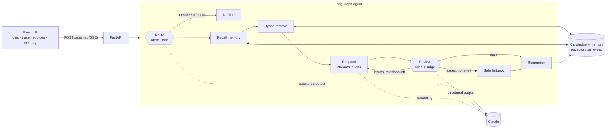

# Ashariri

**A digital twin that answers in my voice, grounded in what I have actually written and built.**

Ashariri is an agent, not a chatbot with a long prompt. Each question goes through a LangGraph state machine. The graph routes the question, recalls what this visitor has told it, runs a hybrid search over my writing and case studies, and streams a cited draft. A review step then checks the draft against hard rules and an LLM judge, and sends it back for revision if it fails. Every step streams to the UI, so you can watch the agent work.

https://github.com/user-attachments/assets/307e793a-f145-42b9-88cc-c0fbe7c9f0fc

<sub>▶ The film, with sound (1 min 47 s). <a href="#the-film">How it was made</a>.</sub>

## What it shows

| | |
|---|---|
| **Agent orchestration** | A LangGraph `StateGraph` with conditional routing, a bounded self-correction loop and a safe fallback |
| **Grounded answers** | Hybrid retrieval: vector search plus BM25, merged with reciprocal rank fusion. Citations are inline and clickable |
| **Guardrails** | Deterministic rules (confidential names, personal data, unsupported figures) plus a structured-output LLM judge |
| **Memory with consent** | Episodic and semantic memory scoped to a session. Visitors can see it, switch it off and erase it |
| **Observability** | Every node emits typed events over SSE: the route taken, the passages and their ranks, the verdicts and the timings |
| **Evals** | A YAML suite that scores routing, retrieval hit rate, outcomes and safety on every answer. It runs in CI |
| **Two storage backends** | SQLite + sqlite-vec + FTS5 for zero-infrastructure runs. Postgres + pgvector + tsvector for production |
| **Voice** | Web Speech API for spoken questions and spoken replies |

## Architecture



More detail, including the event protocol and the retrieval design, is in [docs/architecture.md](docs/architecture.md).

## Run it

**Locally, no API key needed.** This uses the scripted model, which answers extractively from the retrieved sources:

```bash
cd backend
uv sync
ASHARIRI_LLM=scripted ASHARIRI_SCRIPTED_DELAY=0.04 uv run ashariri serve   # API on :8000
cd ../frontend && pnpm install && pnpm dev                                 # UI on :5173
```

**With Claude:**

```bash
export ANTHROPIC_API_KEY=sk-ant-...
cd backend && uv run ashariri serve
```

**Full stack with Postgres:**

```bash
cp .env.example .env    # add your key, or set ASHARIRI_LLM=scripted
docker compose up --build
open http://localhost:8080
```

**From the terminal:**

```bash
uv run ashariri chat --trace    # chat, with each graph step printed
uv run ashariri ingest          # rebuild the index after editing knowledge/
uv run ashariri eval --verbose  # run the evaluation suite
```

## Tests and evals

```bash
cd backend && uv run pytest     # store, guardrails, graph paths, API streaming
cd frontend && pnpm test        # SSE parser and event reducer
```

The unit tests use a deterministic scripted model and a hashing embedder, so they are fast and need no network. The eval suite uses the real local embedding model. CI also runs the store tests against a pgvector service container.

```
  intent        14/14
  outcome       5/5
  retrieval     10/10
  confidential  14/14
  style         14/14
```

## Project layout

```
backend/
  ashariri/
    graph.py          the agent: nodes, edges, streamed events
    llm.py            Claude client (structured outputs, streaming) + scripted model
    guardrails.py     deterministic checks on every draft
    store/            SQLite and Postgres backends behind one contract
    embeddings.py     fastembed (bge-small) and a hashing embedder
    api.py            FastAPI + SSE
    evals.py          evaluation runner
  knowledge/          what the twin knows: markdown with front matter
  persona/balaji.yaml voice, beliefs, boundaries, confidential terms
  evals/cases.yaml    evaluation cases
frontend/
  src/components/     AgentGraph, Inspector, MemoryPanel, Answer
  src/useTwin.ts      streaming state: one reducer folds events into messages
```

## The film

The promo is made in code, not screen-recorded. `promo/capture.mjs` runs the real app on the scripted model, asks it questions the way a visitor would and saves DOM snapshots of each moment. `promo/kit/render.mjs` replays those snapshots as live HTML with a moving camera, captions and kinetic type, renders it frame by frame and adds an original score synthesised in Python (`promo/kit/score.py`).

```bash
cd promo && pnpm install
node capture.mjs        # snapshots of the real UI
node kit/render.mjs     # the film, in promo/out/ (upload the -web.mp4 to the README)
```

## Make it yours

The persona and the knowledge are data, not code. Edit `persona/*.yaml` for voice and boundaries, drop markdown into `knowledge/`, run `ashariri ingest`, and add cases to `evals/cases.yaml` for anything the twin must always get right. Names the twin must never say go in `persona/confidential.local.yaml`, a plain YAML list that git ignores, so real internal names never reach the repo.

---

Part of [the Lab](https://balajisriraj.com/#lab), ten agentic products by [Balaji Sri Raj](https://balajisriraj.com).
