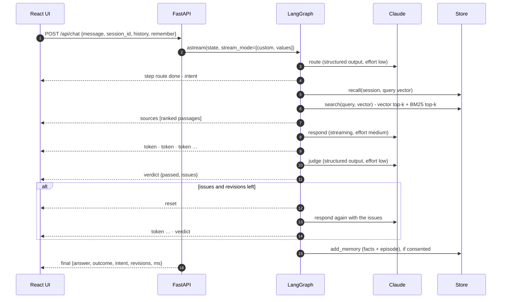

# Architecture

## Request lifecycle

## Nodes

| Node | Does | Model call |
|---|---|---|
| `route` | Classifies intent (work, opinion, personal, smalltalk, out_of_scope, unsafe), writes a search query, picks a tone, extracts facts the visitor shared | Structured output, low effort |
| `decline` | Polite boundary reply for unsafe or off-topic requests. No retrieval happens | None |
| `recall` | All stored facts for the session plus the most relevant past exchanges | None |
| `retrieve` | Hybrid search, then numbered `<source>` blocks for the prompt | None |
| `respond` | Persona brief + memory + sources, then streams a cited reply. On revision it receives the reviewer's issues | Streaming, medium effort |
| `guard` | Rules first, then an LLM judge returns `{grounded, in_voice, safe, issues}` | Structured output, low effort |
| `fallback` | A safe, honest answer when revisions run out | None |
| `remember` | Stores new facts and a one-line episode, deduplicated | None |

The revision loop is bounded by `ASHARIRI_MAX_REVISIONS` (default 1). A draft that still fails after that is never shown; the fallback replaces it.

## Retrieval

- **Chunking.** Markdown is split on headings, then packed into windows of about 700 characters. Each chunk is titled `Document - Section`, and the title is embedded with the text, so a short passage keeps its context.
- **Vector search.** `bge-small-en-v1.5` (384 dimensions) through fastembed, on the CPU. The store is sqlite-vec `vec0` or a pgvector HNSW index with cosine distance.
- **Keyword search.** SQLite FTS5 with the Porter stemmer and BM25, or a Postgres `tsvector` with a GIN index.
- **Fusion.** Reciprocal rank fusion with `k = 60`. A passage ranked well by both searches beats one ranked first by only one. Both ranks go to the UI so the fusion can be inspected.

## Guardrails

The rules are deterministic, so they are cheap and can't be talked out of a decision:

- names from `confidential_terms` in the persona
- any email address except the public one
- phone numbers
- metric-like figures (%, currency, "10x") that do not appear in the retrieved sources

The LLM judge handles what rules can't: unsupported claims, slipping out of voice, and subtle boundary breaches. A draft passes only when both agree.

## Event protocol

Every event is one SSE frame: `event: <type>`, then `data: <json>`.

| type | payload |
|---|---|
| `step` | `node`, `status` (running, done, skipped), `ms?`, `detail?` |
| `sources` | `sources[]`: id, title, source, url, snippet, vector_rank, keyword_rank |
| `token` | `text` |
| `reset` | clears the draft before a revision streams |
| `replace` | `text`: whole reply for decline or fallback |
| `verdict` | `passed`, `issues[]` |
| `final` | `answer`, `outcome` (answered, revised, declined, fallback), `intent`, `revisions`, `ms` |
| `error` | `message` |

The UI folds these into message state with one pure reducer (`frontend/src/useTwin.ts`), which is unit tested.

## Claude usage

- Model `claude-opus-5-5` by default, with `ASHARIRI_MODEL` to override.
- Routing and judging use structured outputs (`output_config.format` with a strict JSON schema generated from the Pydantic models), so the graph never parses free text.
- Effort is set per role: low for routing and judging, medium for replies.
- Server-side fallback (`fallbacks="default"`) retries a declined request on the recommended fallback model. If a refusal still comes back, it becomes a typed `LLMRefusal` that the graph handles.

## Memory and privacy

Memory is keyed by a random session id stored in the visitor's browser. It holds two kinds of entry: `fact`, what visitors say about themselves, and `episode`, a one-line gist of each exchange. Visitors can switch memory off for a request (`remember: false`), list it (`GET /api/memory/{id}`) or erase it (`DELETE /api/memory/{id}`).
